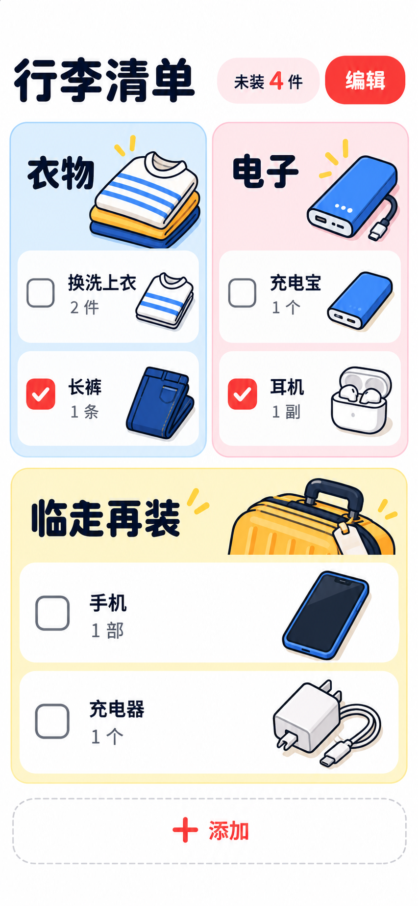
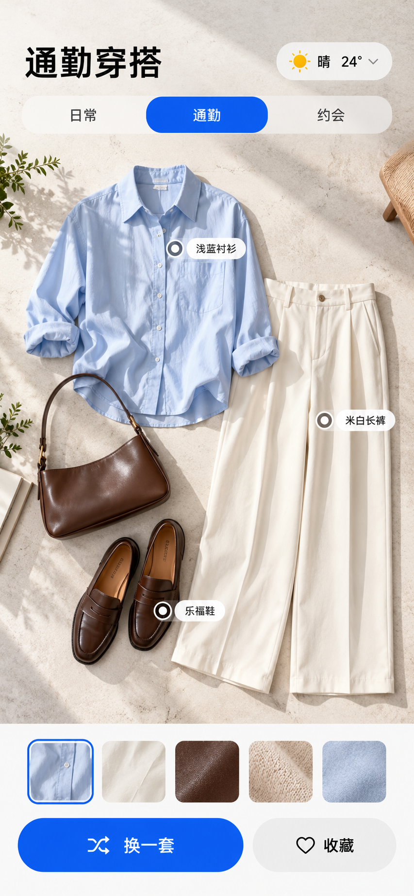
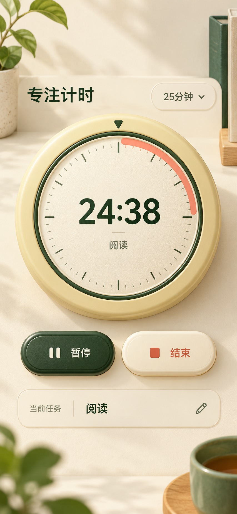
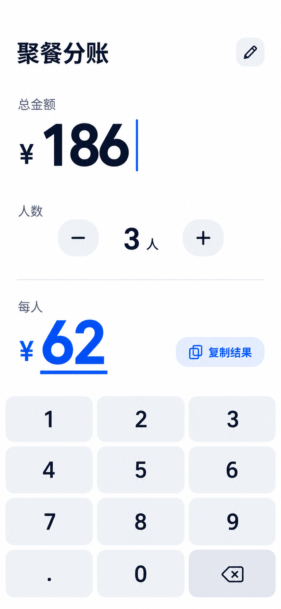
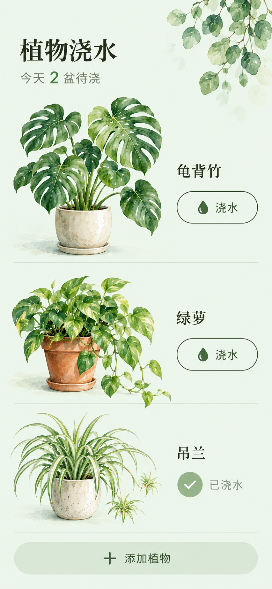
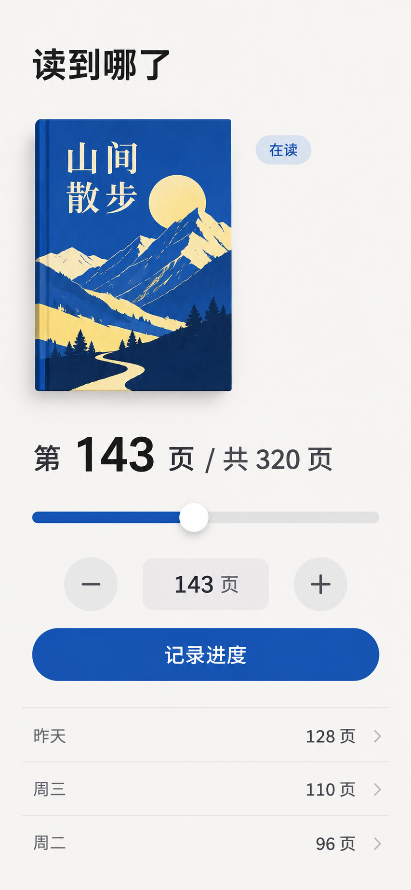

<div align="center">

# 🛠️Small Tool Design Workshop

### 面向小工具创作者的高保真原型设计Skill


**从需求确认到视觉与交互设计，完成可体验、可继续开发的小工具原型**

<p>
  <a href="#showcase">看看样例</a> ·
  <a href="#quick-start">开始使用</a> ·
  <a href="#install">安装 Skill</a> ·
  <a href="#handoff">交给 AI 开发</a> ·
  <a href="https://github.com/Surge-Dan/small-tool-design-workshop/issues">反馈想法</a>
</p>

</div>

小工具设计工坊适合想验证产品、试一试玩法，或把设计交给AI继续开发的人。给它一个想法、一份需求、参考图或已有HTML，从用户要操作什么开始，逐步确定结构、画面和反馈，做成可体验的高保真原型。

> 想法还没成形，可以先聊；方向确定以后，再把画面和交互认真做好。

<a id="showcase"></a>

## 先看看，它可以往哪些方向设计

清单可以用插画区分物品，计时器可以像手边的小物件。不是给所有工具换同一套配色，而是让内容、操作和视觉一起成立。

<table>
  <tr>
    <td width="33%" align="center"><a href="docs/showcase/packing.png"></a><br><b>行李清单</b><br>鲜彩插画 · 清单核对</td>
    <td width="33%" align="center"><a href="docs/showcase/dinner.png"></a><br><b>晚餐搭配</b><br>食物插画 · 预算推荐</td>
    <td width="33%" align="center"><a href="docs/showcase/outfit.png"></a><br><b>通勤穿搭</b><br>编辑式构图 · 搭配选择</td>
  </tr>
  <tr>
    <td align="center"><a href="docs/showcase/focus.png"></a><br><b>专注计时</b><br>物件与材质 · 时间反馈</td>
    <td align="center"><a href="docs/showcase/mood.png"></a><br><b>心情小笺</b><br>轻量文具 · 卡片生成</td>
    <td align="center"><a href="docs/showcase/split.png"></a><br><b>聚餐分账</b><br>数字排版 · 就地计算</td>
  </tr>
  <tr>
    <td align="center"><a href="docs/showcase/plants.png"></a><br><b>植物浇水</b><br>植物水彩 · 日常记录</td>
    <td align="center"><a href="docs/showcase/reading.png"></a><br><b>阅读进度</b><br>书籍与字形 · 进度记录</td>
    <td align="center"><a href="docs/showcase/photo.png"></a><br><b>照片贴纸</b><br>画布编辑 · 素材组合</td>
  </tr>
</table>

以上是借助内置 imagegen 生成的**静态视觉概念图**，用于展示设计方向，不是九款已上线产品，也不是运行或交互测试截图。点击可查看原图；[制作说明与提示词](docs/showcase/README.md)保留生成依据。实际原型仍需落实交互、资源与显示效果，不能用概念图代替代码交付。

## 它能帮你什么

“高级一点”“可爱一点”很难直接变成满意的页面。工坊会把这些要求拆成能看、能试的选择：主角是什么，操作在哪里发生，结果怎样呈现，哪些素材和细节承担风格。

- **选方向有依据**：查看参考，提炼适合本次任务的结构、字形、材质或反馈；不把一张漂亮截图整套照搬。
- **确认看得见**：方向难想象时，先看关键画面，必要时试一次核心操作，再扩展完整原型。
- **效果有制作方法**：把字体、插画、纹理和图形效果纳入计划，按需求选择素材与渲染方式。
- **修改找得到原因**：分开检查画面、行为、动画和显示，保留认可的部分；交接时留下设计决定和实际参数。

### 不会描述风格，也能开始

不必先知道“编辑式”“拟物”是什么意思。说清什么时候用、想省掉什么，工坊会推荐一个具体方向，必要时再给一个有明显取舍的备选。内置[24种风格起点](references/style-library.md)，覆盖信息与编辑、纸本与印刷、插画与图像、物件与场景；按需读取，不是24套固定页面，也不局限于原来六种样例。

有参考图可以直接上传：先提炼构图、中文层级、色彩、轮廓与素材语言，再结合你的工具做新设计；不会把海报硬套成操作页。只有局部截图时，会明确哪些信息尚不能判断。

交给开发也不止一张图：涉及精细插画时，会说明哪些先生成透明底素材、哪些用代码实现，并留下素材规格、提示词、实际文件或待生成项。尽量复用已有素材，不让下一位AI用emoji和粗糙占位图把效果做丢。静态图、可运行原型和未完成项会分别说明。

这些方法用于减少猜测和返工。最终效果仍需看实际产物和你的反馈，不靠自评分保证质量。

<a id="quick-start"></a>

## 使用方式

**已经有具体需求**，安装后在新任务中直接说：

```text
使用$small-tool-design-workshop，做一个晚餐推荐工具。
输入预算和人数，输出菜名、估价和人均价格，支持返回修改。
视觉像菜市场手写价签，离线可用，交付移动端单HTML。
```

**只有一个想法**，也可以从“我想做一个健身记录器”开始。Skill会帮你梳理主要用途，给出可选方向，确认后再做原型。你不必先写一份完整需求文档。

如果需求已经完整，可以直接委托：“按这些要求制作，布局和风格你来定。”已有决定不重复确认，字体、间距和动画曲线等细节由设计师处理。

完整产品文档作为业务输入，不自动视为视觉已确认。视觉未定时，会集中确认关键画面的构图、文字密度、按钮轮廓、插画及操作安排；“做独立原型”只确定交付形式。明确说“风格你来定，直接做”则直接制作，不增加重复问答。

**想修改已有原型**，说清楚改哪里就行：

```text
只改结果页：把推荐理由讲清楚，增加返回修改按钮。
首页、配色和主流程保持不变。
```

### 也可以，给它出一道具体的题

```text
做一个番茄钟，像一只桌上的计时器。打开就能计时，能暂停和结束，不要欢迎页。
```

```text
做一个通勤穿搭工具，画面像服饰杂志，但操作要简单。选天气和场合，能换一套、返回修改。
```

```text
我只想记住这本书读到了哪页。别做读书社区，也别先让我注册账号。
```

你可以只说要解决什么。布局、字体和素材由工坊提出具体建议；你已有完整设计时，它就沿着你的决定完成。

## 🧭制作流程

流程随需求完整度调整，需要你决定的内容集中确认，具体细节由设计师打磨。

1. **弄清任务**：使用场景、操作对象、输入与结果，补关键缺口，留下少量可观察的验收例子。
2. **拆解参考**：先判断画面用于操作、阅读、体验还是传播，再按缺口看结构、艺术和状态参考；不把工具操作页套成宣传封面。
3. **形成视觉语法**：把构图密度、字形层级、控件轮廓、颜色职责、素材和关键行为落实成具体决定，不只确认一个风格词。
4. **完成制作**：先做好关键片段，再扩展状态。列表、计算等可以直接做HTML小样；图像和材质主导时再用生图辅助，不强制增加审批。
5. **对照交付**：把实际渲染与认可画面按相同内容、状态和视口比较，核对构图、字体、密度与素材，再检查核心操作和显示；说明已实现、模拟和未验证范围。

只要玩法，就先讨论玩法；只改一个细节，就检查相关部分。完整方案或明确委托可以直接制作，简单工具不增加无关流程。

修改前保存可恢复版本，写清改动与保留项；修改后同时检查。快照包含HTML、已有设计记录和引用附件，可恢复到新目录，方便找回上一版满意的设计。具体方法见[修改与恢复](references/iteration-and-evidence.md)。

需求确认和修改方法见[需求与评审](references/brief-and-review.md)。

## 🎨视觉设计

视觉从工具的用途出发。图片编辑围绕预览和就地修改，连续记录围绕当前内容，比较工具要让差别看得见。先找到合适结构，再确定怎么表现。

| 设计方式 | 主要打磨什么 |
| --- | --- |
| 版式与字体 | 字级、比例、网格、阅读顺序 |
| 物件与材质 | 结构、边缘、触感、光影 |
| 图片与插画 | 构图、裁切、色板、素材关系 |
| 空间与动态 | 层次、对象关系、运动和操作反馈 |

这些方式可以组合。简约设计重点看比例、留白和细节；复杂设计则要控制层次、素材和动态，让主要操作始终清楚。

风格可以是清爽的记录本、可爱的卡通界面，也可以是复古掌机、杂志拼贴或有空间感的场景。主题会影响内容怎么排列、按钮怎么操作、结果怎么呈现，相关页面和状态也会一起设计。

页头、大标题、插画、卡片和固定底栏不是每页必备。布局按选择、编辑、比较或阅读的任务分别推导；普通按钮在未指定轮廓时优先考虑舒适圆角，但不会把圆角、柔色卡片或某个案例写成所有作品的统一模板。

**素材与渲染**按效果选择。排版、按钮与矢量细节可用HTML/CSS/SVG；照片处理、字符效果和拼贴可用Canvas；确需空间和实时光影时再考虑WebGL。图标库、生图、字体及其他渲染库按实际环境和需求使用，库越多不代表设计越好。

精细插画、艺术字、贴纸和纹理需要实际制作与检查，不能用粗糙占位图代替已确认方向。离线交付将许可允许的资源内嵌，保留来源和必要署名；涉及图片导出时，检查实际文件里的裁切、字体、清晰度与效果。高成本生图、素材购买或长调研先说明范围与成本。

完成后，对照参考特征和已认可画面复查。结构不清楚改结构，素材粗糙补素材，字形失衡调排版，动画没反馈改变化关系。渐变、粉色、卡片、英文或奶油底都不是自动缺陷，关键看是否适合内容、是否协调。

详细方法见[参考解构到原型还原](references/reference-to-prototype.md)、[视觉设计流程](references/visual-sop.md)、[视觉语言](references/visual-language.md)、[常见设计问题](references/anti-ai-slop.md)和[素材与渲染](references/visual-resources.md)。

## 动画与交互

点击、展开、生成和返回都需要清楚的反馈。动画会围绕操作前后的变化来设计，例如新记录出现在哪里、返回后继续编辑哪一项。

除了正常操作，还会根据工具的用途检查这些情况：

- 输入缺失或不合法时，就近说明问题，修正后可以继续。
- 返回修改时保留输入，新结果对应最新内容。
- 连续点击、切换和返回时，数据、焦点与滚动位置合理。
- 删除或清空前有确认或撤销；保存失败、无结果或取消分享时，保留内容并提供适用的恢复方式。
- 动画能处理重复触发和中途返回；开启减少动效后，状态变化仍然清楚。

动画的时长和曲线按任务与风格调整。静态截图用于检查画面，动画需要实际操作检查。具体方法见[动画与交互](references/motion-and-interaction.md)。

## 原型交付

默认提供：

- 一个可离线打开的HTML，内嵌CSS、JavaScript和必要资源。
- 简短的设计说明，包括核心任务、操作路径和视觉依据。
- 已实现内容、实际检查结果、关键假设和限制。

默认按移动端设计，以390×844为主要基准，同时检查窄屏和长内容。电脑打开也居中保持手机宽度；明确需要桌面版时再适配。离线要求在关闭缓存、禁用网络后首次打开检查，未测试的设备和环境会标明。

需要持续记录时，可以按需求实现本机保存、历史回看和数据导出，并说明存储位置与备份方式。本机保存不包含跨设备同步。真实账号、支付、服务端数据库和生产API需要另行明确需求。

<a id="handoff"></a>

## 📦开发参考包

需要交给AI写代码时，直接说：“把当前原型导出成AI开发参考包。”

```text
工具名-handoff.zip
└── 工具名-handoff/
    ├── prototype.html      可运行原型
    ├── design-spec.json    需求、状态与设计参数
    ├── HANDOFF.md          交接说明与验收要求
    ├── AI-START.md         下一位AI的开工说明
    ├── ARTIFACT.json       原型与证据的版本清单
    ├── screenshots/        有实际截图时附带
    └── evidence/           有文本证据附件时附带
```

参考包保留原型、需求、页面状态、交互规则、设计参数和验收说明，还可记录操作对象、结构理由、参考如何影响设计、素材与渲染策略。关键动画记录触发、前后状态、时长曲线、中断和减少动效行为，让下一位AI理解该保留什么。

解压后，把整个目录交给能读取本地文件的AI，让它先读AI-START.md，再按你的目标平台和技术栈实现。只支持附件的工具，优先提供HTML、HANDOFF.md和关键截图。

缺少截图或动态验证时，会在交接说明中标明。只要单HTML时，不强制生成参考包，也不会在原型里添加面向开发者的导出按钮。

打包器仅依赖Python标准库，检查确认状态、文件引用和证据，生成目录与ZIP。草稿、未解决的关键问题或无效引用会阻止导出，已有输出不会被覆盖。打包成功只说明记录与文件符合要求，原型仍需实际运行检查。

新记录和证据可绑定实际HTML版本。HTML或已绑定附件变化后，导出会提示失效并停止；旧版未绑定记录仍可导出，并明确说明版本无法核验。哈希用于核对文件，不代表功能或视觉已经通过检查。

详细格式见[开发交接](references/developer-handoff.md)。

<a id="install"></a>

## 安装方式

把仓库地址交给支持 Skill 安装的 Agent 即可：

```text
帮我安装这个 Skill：https://github.com/Surge-Dan/small-tool-design-workshop
```

在Codex环境中，通过Skill安装器执行：

```powershell
python "$env:USERPROFILE\.codex\skills\.system\skill-installer\scripts\install-skill-from-github.py" `
  --repo Surge-Dan/small-tool-design-workshop `
  --path . `
  --name small-tool-design-workshop
```

安装后，在新任务中使用`$small-tool-design-workshop`，也可以直接描述需求，让Agent按任务匹配Skill。

已经安装旧版时，让 Agent **更新现有 Skill**，而不是只确认安装目录存在；更新前保留你的本地定制。

## 项目结构

| 文件 | 用途 |
| --- | --- |
| [SKILL.md](SKILL.md) | Skill入口与工作要求 |
| [references/](references/) | 需求、视觉、交互与交付方法 |
| [agents/openai.yaml](agents/openai.yaml) | Codex展示信息与调用设置 |
| [assets/design-spec.template.json](assets/design-spec.template.json) | 设计记录模板 |
| [scripts/build_handoff.py](scripts/build_handoff.py) | 初始化记录、校验并导出参考包 |
| [scripts/prototype_state.py](scripts/prototype_state.py) | 保存与恢复版本、绑定已观察的证据 |
| [scripts/design_review.py](scripts/design_review.py) | 将已有参考与关键画面整理成离线对照总览 |
| [scripts/viewport_probe.js](scripts/viewport_probe.js) | 在浏览器读取实际容器、居中与溢出候选 |
| [tests/test_build_handoff.py](tests/test_build_handoff.py) | 打包器测试 |
| [tests/test_prototype_state.py](tests/test_prototype_state.py) | 版本恢复与证据绑定测试 |
| [evals/evals.json](evals/evals.json) | 评估提示词与预期行为 |
| [evals/comparison.md](evals/comparison.md) | 内部真实任务对照方法 |

## 本地验证

运行打包器测试：

```text
python -m unittest discover -s tests -v
```

初始化设计记录，再填入实际需求、状态和验证结果：

```text
python scripts/build_handoff.py init --output <项目目录>/design-spec.json --title <工具名>
python scripts/build_handoff.py build --spec <项目目录>/design-spec.json --html <项目目录>/原型.html --output <新目录>/工具名-handoff
```

这些检查覆盖记录格式、打包、版本恢复、证据失效和辅助工具。视觉效果、动画和使用体验需要在实际原型中单独验证。

需要并排查看参考、认可画面与当前状态，或检查手机容器时，使用[检查工具](references/review-tools.md)。总览区分参考和原型证据，探测器提供实际边界；两者都不生成审美评分，也不代替真机和离线测试。

## 方法依据

流程借鉴[Design Council双钻](https://www.designcouncil.org.uk/resources/framework-for-innovation/)的问题探索与方案收敛，以及[native-subtitle-quote-image](https://github.com/chengyi-ai/native-subtitle-quote-image)将视觉要求落实为参数、预览和逐项质检的方法。借鉴的是工作方式，具体布局和效果仍从你的需求推导。

动效参考[Google的设计方法](https://design.google/library/making-motion-meaningful)，关注对象关系和状态变化；复杂信息通过[渐进披露](https://www.nngroup.com/articles/progressive-disclosure/)按需展开。内部对照保留实际产物、操作成本和用户反馈，未验证前不宣称优于普通Agent。

本页的快速入口与作品预览编排参考了[Hyperframes](https://github.com/heygen-com/hyperframes)的展示方式，示例图为本项目另行制作，没有复制其作品或品牌素材。

## 💬贡献与反馈

欢迎提交[Issue](https://github.com/Surge-Dan/small-tool-design-workshop/issues)或[PullRequest](https://github.com/Surge-Dan/small-tool-design-workshop/pulls)。为了方便定位问题，请尽量提供：

- 可复现的需求描述、操作步骤或脱敏后的输入示例；
- 使用的Agent、Skill版本和运行环境，报错时附完整错误信息；
- 期望效果与实际结果之间的差异。

视觉或交互问题，欢迎附上截图或最小HTML文件。分享前请移除真实账号、APIKey、Cookie及其他个人敏感信息。

如果它帮你把一个小想法做成了满意的原型，欢迎点一个⭐，让更多创作者发现它。

## Star History

[](https://www.star-history.com/#Surge-Dan/small-tool-design-workshop&Date)
